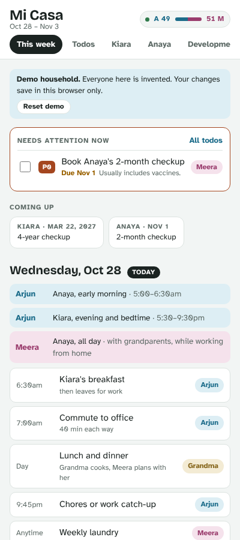
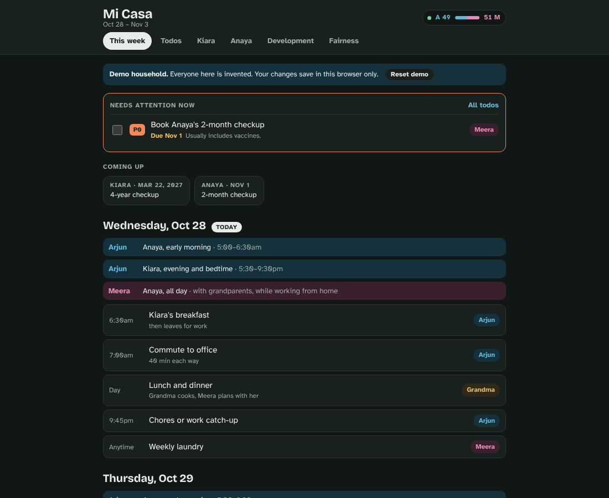

# Mi Casa

**A household hub for two busy parents: who's doing what this week, whether the load is fair, and what each kid needs next.**

Two working parents with a preschooler and a newborn open Mi Casa in the morning to see the week at a glance: who's on breakfast, who has the baby, who's taking the older one to swim. When something shifts, they hand a card to the other person or drag it to another day. A small badge in the corner shows how the week's load is split between them, counting paid work and commute as well as chores, so the person with the long office days isn't marked down for doing fewer dishes.

**Live demo:** https://yutika-agarwal.github.io/mi-casa/ (an invented family; changes save only in your browser)

| Phone | Desktop (dark) |
|---|---|
|  |  |

## What it does

- **This week.** A rolling seven days, today first. Each day opens with a band for long, overlapping duties ("Meera has the baby all day") and then small cards for chores and calendar events. Tap a card to reassign it or move it to another day.
- **Fair-share badge.** Each parent's share of the combined weekly load, in hours. Green between 45% and 55%. Tap it for the full breakdown.
- **Todos with three priorities.** P0 needs attention now and also shows at the top of the week. P1 is for the next week or so. P2 is long term and planned, such as a renovation or choosing a school.
- **A tab per kid.** Age, school, and a dated timeline generated from the birth date: well-child checkups, birthdays, and transitional kindergarten and kindergarten years under California's Sept 1 cutoff. Milestones that need action become P2 todos linked to that kid.
- **Development notes.** For each kid, physical, emotional and mental/educational: where she is, and what would help.

## Why this design

The first version put each parent's score front and centre in big type. It read like a scoreboard, which is exactly the feeling the product is meant to remove. The score moved to a small badge, and the explanation moved to a tab you open only when you want to check the math.

Two alternatives I rejected:

1. **A chore checklist with points per task** (the usual chore-app model). It ignores the biggest real driver of who has time: paid work, commute, and hours spent alone with a kid. A parent who commutes 80 minutes a day would always look like they're slacking.
2. **A private "who does what" audit that each partner fills in separately and then compares** (inspired by fair-share card decks). Good for one honest conversation, too heavy to keep up every week. Mi Casa keeps the weekly board light and saves the deeper reflection for the Development and Fairness tabs.

### How the score works

Each parent's weekly load is the sum of:

- fixed commitments in hours: paid work, commute, and time covering the kids. Shared or light-touch time, like the baby while grandparents are also home, counts at half;
- the chore cards they own this week, in hours. Cards owned by "Both" split evenly. Work done by a grandparent or house help doesn't count for either parent, but planning it does.

The score is each parent's share of the total. Every number is editable in the Fairness tab.

## What I tested and what failed

`npm test` runs 27 checks on the logic that must never be wrong: date handling across daylight-saving changes, the load math, the transitional kindergarten cutoff, milestone dates, due-date status and sorting, and a privacy check that no real family details ship in the public code.

```
# tests 27
# pass 27
# fail 0
```

Problems found and fixed along the way:

- `node --test tests/` treats the folder as a file on Node 22, so the test script now names the files.
- Google Calendar returns all-day events as `2026-10-28T00:00:00Z`. Read as a timestamp, that lands on the previous day anywhere west of UTC, so dates are parsed as plain local dates (covered by a test).
- In the first version the load split sat in large type at the top of every screen. Feedback was that it felt "right in your face", so it became the corner badge.

I also drove the demo in a headless browser at phone and desktop widths, in light and dark mode: no horizontal scrolling, no console errors, and moves survive a reload and clear on "Reset demo". It hasn't been tested with a screen reader yet.

## Success metrics

- **North star:** weeks in which both parents opened the hub at least three times.
- **Inputs:** cards reassigned or moved per week (the board reflects reality), P0 todos closed within 3 days, kid milestones turned into todos before they're due.
- **Guardrails:** weeks where the split sits outside 45–55% for three weeks running (a real imbalance nobody is addressing), and edits to the Fairness hours (frequent edits suggest the numbers feel unfair).

Event schema, if analytics were added (the demo collects nothing):

| event | fields |
|---|---|
| `card_moved` | `card_type`, `from_owner`, `to_owner`, `days_shifted` |
| `todo_changed` | `priority`, `action` (`added`, `done`, `reprioritized`), `has_due`, `kid_linked` |
| `split_viewed` | `share_a`, `balanced` |

## Risks and how they're handled

- **Privacy.** A household board holds sensitive details about children. The public demo uses an invented family and saves only to the visitor's browser. The private version the family uses keeps its data in an access-controlled store shared only between the two parents. A test fails the build if real names appear in the public code.
- **The score becoming a weapon.** It's a share, not a ranking. It counts paid work and commute, and it sits in a small badge rather than a headline. The aim is "is this week roughly fair?", not "who did more?".
- **Health information.** Checkup timings and age milestones follow the usual US pediatric schedule and are labelled as general guidance. The app never gives medical advice and points to the pediatrician.
- **Bias.** The model counts hours, so emotional and planning work can be undercounted. Planning time (meal planning, social plans, coordinating help) has its own rows, and the Development tab exists for the work that doesn't fit in hours.

## Roadmap

- **Now:** the private version runs as a Claude artifact with shared storage and a live Google Calendar feed for both parents.
- **Next:** add and edit recurring chores and the daily coverage bands from the screen, instead of in code; refresh kids' school updates from email on a schedule.
- **Later:** a self-hosted version (Node and SQLite on a home Mac mini, reached privately over Tailscale), and a monthly "how did we do" check-in built from the history.

## Run it locally

No build step. Any static file server works, because the app uses ES modules.

```sh
git clone https://github.com/Yutika-agarwal/mi-casa.git
cd mi-casa
npm start        # serves the folder at http://localhost:3000
npm test         # runs the 27 checks (Node 20+)
```

More detail: [docs/PRD.md](docs/PRD.md) and [docs/metrics.md](docs/metrics.md).

## License

MIT
